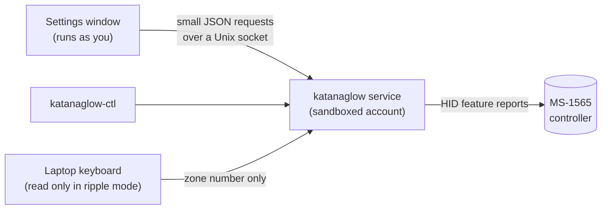
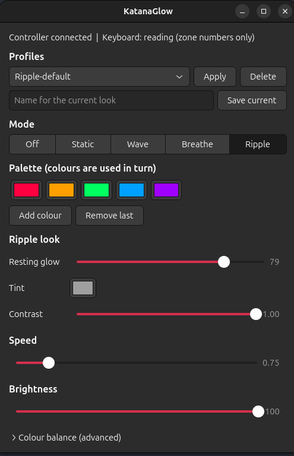

# KatanaGlow

**Keyboard lighting for the MSI Katana 15 B13VFK on Linux**: a colour per zone, wave, breathe, and a reactive
ripple that spreads out from the keys you press. It comes with a settings window, a command-line tool, saved
profiles, and a sandboxed background service that starts at boot and remembers your settings.

> Unofficial community project. Not affiliated with, endorsed by, or supported by MSI. See
> [Disclaimer](#disclaimer).

## Features

- **Modes:** static (one colour per zone), wave, breathe, ripple, off
- **Ripple:** a pulse that spreads from the zone of each key press, with a palette of colours used in turn,
  an optional dim resting glow, and a contrast control so colours stand out over a bright glow
- **Settings window** (GTK 4) and a **command-line tool** (`katanaglow-ctl`)
- **Profiles:** save and recall named looks
- **Remembers everything** across reboots and suspend/resume; applied at boot, before you log in
- **Least privilege:** the service runs as its own account with no network access, a read-only view of the
  system, and access to only the lighting controller and input devices. The window runs as you and can only
  send settings. Key presses are read **only in ripple mode** and never stored, logged or shared
- **Strict by design:** the program can only send two kinds of command to the controller, and refuses
  everything else in code

## Status and hardware support

| Laptop | Controller | Status |
|---|---|---|
| MSI Katana 15 B13VFK | MSI MysticLight MS-1565, USB `1462:1601` | **Verified on the author's unit:** static colour, four independent zones, off, software-drawn effects at up to 60 fps, saved lighting restored after reboot |
| Other laptops using the same controller (for example the Katana 15 B12V) | same | **Not verified by this project.** Other people's notes describe the same protocol. Please send a [hardware report](docs/HARDWARE.md) |

What it does **not** do:

- **No per-key lighting.** The controller exposes four zones (left block, centre, right block, numpad), so
  ripple is a coarse pulse across four columns, not a per-key effect.
- **Hardware effect modes** (the controller's own wave and breathing) are **not used or verified**. Wave and
  breathe are drawn by the service using only static-colour commands, so the service has to be running.
- Layout data is for the **ANSI** keyboard only (ISO contributions welcome).

## How it works



Details are in [docs/ARCHITECTURE.md](docs/ARCHITECTURE.md), and what is known about the controller's
protocol is in [docs/PROTOCOL.md](docs/PROTOCOL.md).

## Requirements

- Linux with systemd and udev. Developed and tested on a recent Ubuntu with GTK 4.22; other distributions
  are untested.
- Python 3.10 or newer (standard library only for the service and the command line)
- For the settings window: GTK 4 with PyGObject (Ubuntu: `python3-gi` and `gir1.2-gtk-4.0`, normally
  preinstalled on the desktop edition)
- Root access to install (`sudo`)

## Install

```bash
git clone https://github.com/Abhyjeet17/katanaglow.git
cd katanaglow
sudo bash deploy/install.sh
```

The installer prints each step. It:

1. creates an unprivileged system account, `katanaglow`
2. copies the program to `/opt/katanaglow` (owned by root)
3. installs the `katanaglow-ctl` and `katanaglow-gui` commands and an app-menu entry
4. installs a udev rule that gives the `katanaglow` account (only) access to the controller
5. installs a hardened systemd service
6. adds your account to the `katanaglow` group, which allows sending settings to the service
7. starts the service and enables it at boot

Log out and back in once so the group membership applies. You can read every script before running it.

**Update:** pull the latest version and run `sudo bash deploy/install.sh` again. Settings are kept.
**Remove:** `sudo bash deploy/uninstall.sh` (add `--purge` to delete saved settings and the account too).

## Usage

Open **KatanaGlow** from the app menu, or run `katanaglow-gui`. Closing the window leaves the lighting running.

```bash
katanaglow-ctl status
katanaglow-ctl static FF0000                         # one colour everywhere
katanaglow-ctl static FF0000,00FF00,0000FF,FFFFFF    # one per zone, left to right
katanaglow-ctl wave FF0040,00A0FF                    # also: breathe, ripple (palette optional)
katanaglow-ctl base 202020                           # dim white resting glow for ripple
katanaglow-ctl punch 0.8                             # ripple colour contrast over a bright glow
katanaglow-ctl brightness 0.5 ; katanaglow-ctl speed 1.5 ; katanaglow-ctl off
katanaglow-ctl profile save "Night" ; katanaglow-ctl profile load "Night" ; katanaglow-ctl profiles
```

### Settings

| Setting | Range | Default | Notes |
|---|---|---|---|
| `mode` | static, wave, breathe, ripple, off | ripple | |
| `brightness` | 0 to 1 | 1 | applied in software |
| `speed` | 0.25 to 4 | 1 | scales wave, breathe and ripple |
| `zone_colours` | 4 colours | | static mode, left to right |
| `palette` | 1 to 8 colours | five colours | wave, breathe, ripple |
| `base` | a colour | black | ripple resting colour |
| `punch` | 0 to 1 | 0 | ripple contrast; 0 is the plain blend |
| `gain` | three values, 0 to 1 | 1, 0.8, 0.7 | colour balance (red, green, blue) |

Colours are six hex digits (`RRGGBB`). The full guide is [docs/USER_GUIDE.md](docs/USER_GUIDE.md).

### Images


## Security and privacy

- The service account has no network access, no home-folder access, no capabilities and a read-only view of
  the system, and can open only raw HID and input devices.
- The keyboard is read **only while the mode is ripple**. Each press becomes a zone number inside the
  service and is discarded. Key codes are never stored, logged, or sent to the window or command line.
- The control socket accepts small, strictly validated requests from members of the `katanaglow` group only.
- Settings and profiles are stored in `/var/lib/katanaglow`, readable only by the service account.

To report a vulnerability, see [SECURITY.md](SECURITY.md).

## Safety

Only two commands are ever sent to the controller: select zones, and set a static colour or off. Everything
else, including the commands other people have documented for saving to or resetting the controller's
memory, is deliberately never sent. Nothing is written to the keyboard's own memory, so a reboot restores the
keyboard's saved lighting, and the service then re-applies yours.

## Troubleshooting

```bash
katanaglow-ctl status                    # service up? controller connected?
journalctl -u katanaglow -e --no-pager   # what the service logged
```

More in the [user guide](docs/USER_GUIDE.md#troubleshooting).

## Development

```bash
python3 -m unittest discover -s tests -v    # no hardware or display needed
```

The window logic is tested against a stand-in for GTK, which cannot prove the GTK calls themselves; those
need a real display. See [CONTRIBUTING.md](CONTRIBUTING.md) for what is most useful: hardware reports for other
laptops, an ISO layout map, and verifying the hardware effect modes on a unit that is safe to experiment with.

```
katanaglow/    the program (protocol, device, effects, daemon, settings window, CLI)
data/          which key belongs to which zone (ANSI)
deploy/        systemd unit, udev rule, account definition, install and uninstall scripts
docs/          user guide, architecture, protocol notes, hardware reports
tests/         unit tests (service, effects, settings, window logic)
tools/         read-only hardware report script
```

## Credits and licence

MIT licensed, see [LICENSE](LICENSE). The packet layout comes from natanalt's published reverse-engineering
notes for this controller, cross-checked against the LightShow project's protocol documentation and verified
on a B13VFK. OpenRGB was used as a reference only. No code was copied from any of these projects; the
protocol layer is written from the documented layout.

## Disclaimer

This software talks to your laptop's lighting controller through a reverse-engineered protocol. It sends only
a small set of volatile commands that have been checked on one unit, but it comes with **no warranty**, and
you use it at your own risk. MSI, Katana and Mystic Light are trademarks of Micro-Star International; they
are used here only to describe compatibility.
