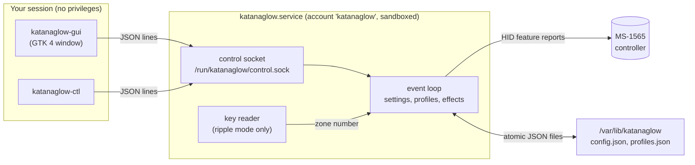

# Architecture

## Processes



The service is the only thing that touches the hardware or the keyboard. The window and the command-line
tool are thin clients of its control socket, so neither needs any privilege.

## Modules (`katanaglow/`)

| Module | Responsibility |
|---|---|
| `protocol.py` | Builds the two allowed packets (zone select, static or off) and refuses anything else |
| `device.py` | Finds the controller by its USB ID in sysfs and sends feature reports; `RecordingDevice` is the test double |
| `effects.py` | `RippleEngine`, `Lighting` (turns settings plus time into four colours), `ZonePainter` (sends only zones that changed) |
| `config.py` | Settings model, strict validation, profiles, atomic saving |
| `daemon.py` | The service: event loop, control socket, settings and profiles, reconnect, resume handling |
| `evdev_input.py` | Read-only key press reader, found by device name |
| `zonemap.py` | Key names to Linux keycodes; loads `data/zonemap_ansi.json` |
| `client.py`, `ctl.py` | Socket client and the `katanaglow-ctl` command |
| `gui.py`, `gui_model.py` | The GTK 4 window, and its logic that needs no display |

The effects code never reads a clock or touches hardware: time goes in, colours come out, so it is tested
without a keyboard.

## The control socket

Newline-delimited JSON over a Unix socket (`/run/katanaglow/control.sock`, mode 0660, group `katanaglow`).
Requests over 16 KiB, malformed JSON, unknown commands and invalid values are rejected without changing
anything; at most 8 clients connect at once.

```json
{"cmd": "get"}
{"cmd": "status"}
{"cmd": "set", "config": {"mode": "wave", "speed": 1.5}}
{"cmd": "profiles"}
{"cmd": "save_profile", "name": "Night"}
{"cmd": "load_profile", "name": "Night"}
{"cmd": "delete_profile", "name": "Night"}
```

Replies are `{"ok": true, ...}` or `{"ok": false, "error": "..."}`. `set` takes a partial update; the merged
result is validated as a whole.

## Effects

All effects are drawn in software from the verified static-colour command, four zones at a time.

- **Static:** one colour per zone.
- **Breathe:** brightness follows a raised cosine, 4 s per breath at speed 1; the next palette colour each breath.
- **Wave:** the palette is sampled as a smooth, wrapping gradient across the four zones and slid along in
  time, 3 s per cycle at speed 1. A one-colour palette fades to black and back so the wave is visible.
- **Ripple:** each key press starts a pulse at the zone of the key. It reaches the next zone after `0.06 s / speed`,
  rises over `0.05 s / speed`, then decays with a time constant of `0.15 s / speed`. Strength drops by 25% per
  zone of distance. Up to 8 ripples overlap; their colours blend by strength. Each ripple takes the next palette
  colour. Between ripples the zones show the resting colour (`base`).
- **Contrast (`punch`):** raises a ripple's weight to the power `1 - 0.5 * punch`, so colour takes over sooner,
  and dims the resting colour up to 70% across the keyboard while a ripple passes. 0 is the plain blend.
- **Brightness and colour balance** multiply the final colours. Pure black is sent as the controller's "off"
  mode, which darkens fully; static black can leave a faint glow.

Frame rate: 30 fps while a ripple is active, 20 fps for wave and breathe, and a 0.5 s idle tick otherwise.
Only zones whose colour changed are sent.

## Robustness

- **Unplug or error:** a failed send drops the device; the service retries every 2 s and resends everything
  after reconnecting.
- **Suspend and resume:** `CLOCK_MONOTONIC` stops during suspend while `CLOCK_BOOTTIME` does not. A gap of
  more than 2 s means the machine slept, so the lighting is re-applied at once and again 1.5 s later, in case
  the controller's firmware reloads its own lighting late.
- **Saving:** settings are written 0.5 s after the last change, to a temporary file that is then renamed
  into place, so a crash never leaves half a file. A damaged settings or profiles file falls back to defaults
  and is reported in the log.
- **Shutdown:** SIGTERM saves pending changes and removes the socket.

## Privilege model

| Piece | Runs as | Can |
|---|---|---|
| Service | `katanaglow` (no login shell) | Open the controller (udev rule), read input devices (only in ripple mode) |
| Window, CLI | you | Send validated settings through the socket |

Systemd sandbox: no network (`PrivateNetwork`), read-only system, no home folders, no capabilities,
`NoNewPrivileges`, a deny-list system-call filter, and a device policy that allows only raw HID devices and
(read-only) input devices. `systemd-analyze security` rates the unit "SAFE".

## Testing

Unit tests run without hardware or a display: packet bytes and the allowlist, settings validation, every
effect, the daemon (a real daemon process against a fake controller and a fake key stream, including
reconnect, persistence and malformed input), profiles, the CLI, and the window logic against a stand-in
for GTK. What they cannot prove: the GTK calls themselves, and real-hardware behaviour. Both need real
machines, which is why hardware reports matter.
